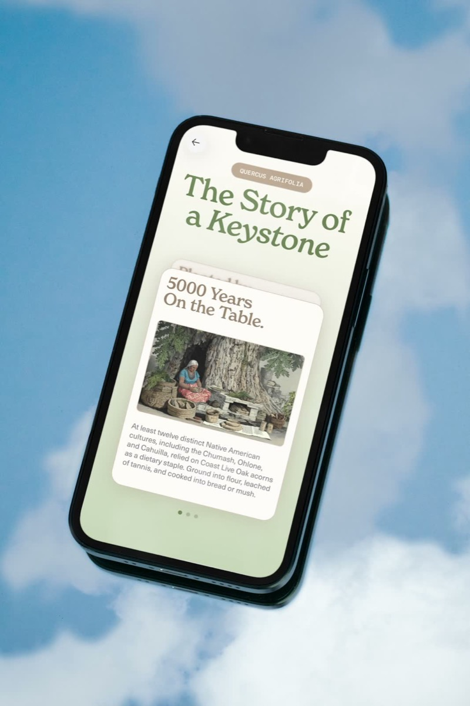
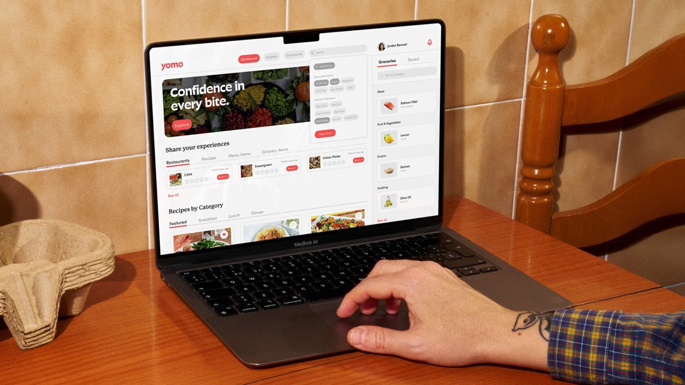

# Media Frame

## Examples

```html example
<div class="mh-split">
  <a class="mh-media" href="#"></a>
  <a class="mh-media" data-stroke href="#"></a>
</div>
```

### Ratios

```html example
<div class="ds-demo-row" style="align-items:flex-start;flex-wrap:nowrap">
  <div class="mh-media" style="flex:1.6"></div>
  <div class="mh-media" data-ratio="4:5" style="flex:1"></div>
  <div class="mh-media" data-ratio="1:1" style="flex:1"></div>
</div>
```

### Video with poster

```html
<div class="mh-media">
  
  <video src="clip.mp4" poster="poster.jpg" muted loop playsinline autoplay preload="metadata"></video>
</div>
```

## Usage

- **Square corners, always.** No radius, no shadow.
- **16:9 is the default** for thumbnails and hero media. Use 4:5 / 1:1 / 3:2 in case-study galleries when the asset calls for it, and `auto` to keep an asset's own ratio.
- **Stroke** (`data-stroke`): a 1px Stroke Gray inset outline, for media on white or near-cream backgrounds (product shots, UI) that would otherwise bleed into the page. It's a per-project CMS field (`Thumbnail Stroke`).
- **Hover**: when the frame is in a link, the image scales to 1.02 over 420ms Snappy. The frame stays still.
- **Video**: the poster image stays painted under the video, and the video fades in once it can play. Never leave a blank frame between them.
- Placeholder color is white (`--mh-bg-media`).

## API

| Attribute | Values | Effect |
| --- | --- | --- |
| `class="mh-media"` | n/a | `position: relative`, `overflow: hidden`, 16:9, children cover |
| `data-ratio` | `4:3`, `3:2`, `1:1`, `4:5`, `auto` | Aspect ratio |
| `data-stroke` | n/a | 1px inset `--mh-border-stroke` outline |

## Accessibility

- Every meaningful image needs `alt` that describes it ("AirPods Pro 3 earbuds on a white background"). Decorative duplicates (posters under video) get `alt=""`.
- Autoplay video must be `muted` and `playsinline`, and must pause under reduced motion or offscreen.

## Framer mapping

- Case-study media: `ResponsiveCaseStudyImage` (`vIFnGmg`) and `ResponsiveCaseStudyVideo` (`bsTLKCt`); galleries: `CaseStudyJustifiedMediaGrid` (`c0iPrbN`), `DoubleStackGalleryGrid`, `MatchedStackMediaPair`.
- Stroke: `CaseStudyThumbnailStrokeStyles` (`Z28JYvA`) reads the CMS `Thumbnail Stroke` field (`OHdUYs6Mo`) and paints `#979797`.
- Playback budget and offscreen pausing: `CaseStudyVideoManager` (`rGMwETR`). Don't add a second video controller.
- Optimize media with `code/tools/` image-optimizer before upload (see `docs/performance-media-deployment-checklist-2026-07-23.md`).

## Don't

- Don't round corners or add captions inside the frame.
- Don't letterbox with colored bars; crop with `object-fit: cover`.
- Don't scale the frame on hover; scale the image inside it.
