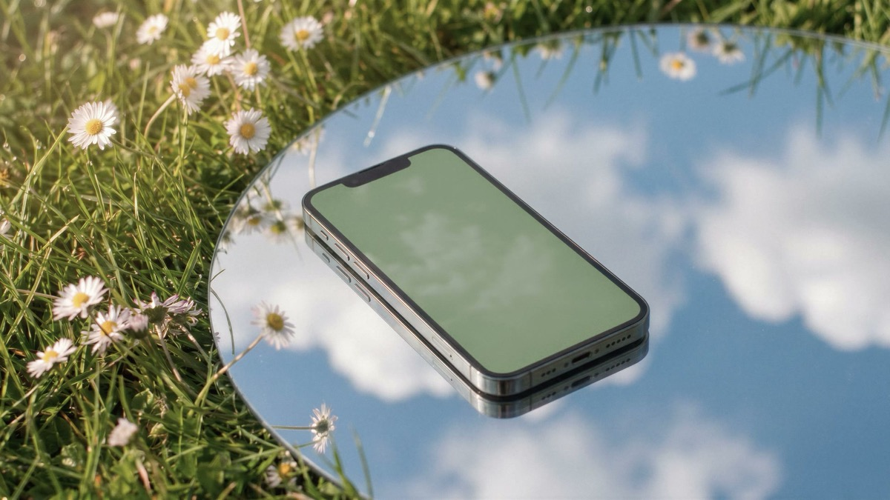
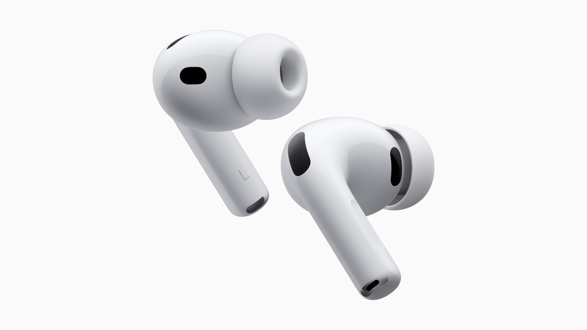
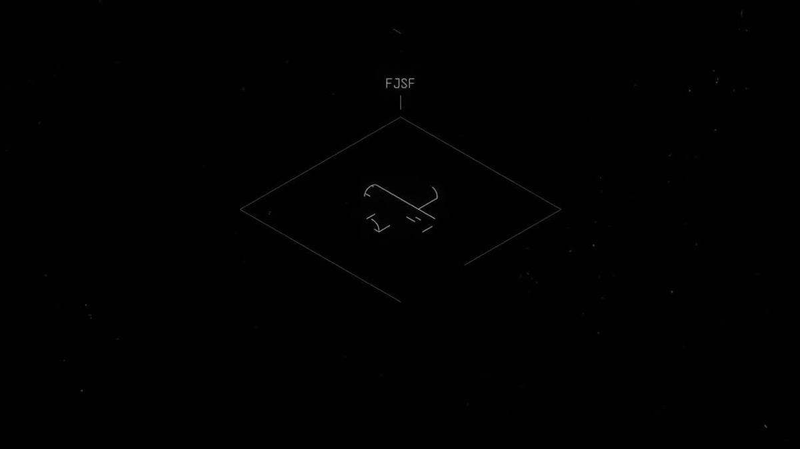

# Project Card

## Examples

### Two columns (Home)

```html example
<ul class="mh-project-grid">
  <li class="mh-project-card">
    <a class="mh-project-card__link" href="#">
      <div class="mh-project-card__meta mh-label">
        <span>1</span><span>/</span>
        <span class="mh-flip"><span class="mh-flip__track"><span>Gaia</span><span aria-hidden="true">View project</span></span></span>
      </div>
      <div class="mh-media"></div>
    </a>
    <ul class="mh-tags"><li class="mh-tag">Visual identity</li><li class="mh-tag">UX/UI</li><li class="mh-tag">Strategy</li></ul>
  </li>
  <li class="mh-project-card">
    <a class="mh-project-card__link" href="#">
      <div class="mh-project-card__meta mh-label">
        <span>2</span><span>/</span>
        <span class="mh-flip"><span class="mh-flip__track"><span>AirPods Pro 3</span><span aria-hidden="true">View project</span></span></span>
      </div>
      <div class="mh-media" data-stroke></div>
    </a>
    <ul class="mh-tags"><li class="mh-tag">2D motion</li><li class="mh-tag">3D motion</li><li class="mh-tag">Social media</li></ul>
  </li>
</ul>
```

### Three columns (Other projects, Index grid)

```html example
<ul class="mh-project-grid" data-columns="3">
  <li class="mh-project-card"><a class="mh-project-card__link" href="#"><div class="mh-project-card__meta mh-label"><span>2</span><span>/</span><span class="mh-flip"><span class="mh-flip__track"><span>AirPods Pro 3</span><span aria-hidden="true">View project</span></span></span></div><div class="mh-media" data-stroke></div></a></li>
  <li class="mh-project-card"><a class="mh-project-card__link" href="#"><div class="mh-project-card__meta mh-label"><span>3</span><span>/</span><span class="mh-flip"><span class="mh-flip__track"><span>Peak Energy</span><span aria-hidden="true">View project</span></span></span></div><div class="mh-media"></div></a></li>
  <li class="mh-project-card"><a class="mh-project-card__link" href="#"><div class="mh-project-card__meta mh-label"><span>4</span><span>/</span><span class="mh-flip"><span class="mh-flip__track"><span>Gaia</span><span aria-hidden="true">View project</span></span></span></div><div class="mh-media"></div></a></li>
</ul>
```

## Anatomy

1. **Meta row**: mono label in a `24px 11px 1fr` grid: number, slash, title. The title is a flip rail whose second line reads **VIEW PROJECT**.
2. **Media**: [Media Frame](media-frame.md), 16:9, optional 1px stroke.
3. **Tags**: up to three [Tags](tag.md), outside the link so they can be their own filters.

## Usage

- Number cards in display order from 1, without zero padding. Titles are CMS titles, uppercased by CSS.
- Hover or focus does two things together: the title rolls up to VIEW PROJECT and the image scales to 1.02 (both 420ms Snappy). Below 810px neither moves.
- Keep a poster image under any thumbnail video, so a returning visitor never sees an empty frame.

| Grid | Desktop | Tablet | Mobile | Where |
| --- | --- | --- | --- | --- |
| `mh-project-grid` | 2 | 2 | 1 | Home: exactly six cards, then View all right-aligned 30px below (20px phone) |
| `data-columns="3"` | 3 | 2 | 1 | Case-study Other projects (three cards, no tags); Index grid view |

Gaps are 20px between columns and 50px between rows. No masonry, mixed sizes or pagination.

## API

| Class | Element | Notes |
| --- | --- | --- |
| `mh-project-grid` | `ul` | 2-column grid; `data-columns="3"` for three |
| `mh-project-card` | `li` / `article` | Column, 16px gap |
| `mh-project-card__link` | `a` | Wraps meta + media; the hover host |
| `mh-project-card__meta` | `div.mh-label` | `24px 11px 1fr` grid; 13px flip window |

## Data model (CMS)

Cards come from the Framer CMS `All Projects` collection (`yTHrQWMIY`). Never add baked fallback rows or hard-coded media URLs.

| Card field | CMS field | Field id |
| --- | --- | --- |
| Title | Title | `oeXZcmPna` |
| href | `/case-studies/{slug}` | `pdXVG_fBO` |
| Poster image | Thumbnail | `Jy7hBJady` |
| Video | Thumbnail Video | `SvOqFqdby` |
| `data-stroke` | Thumbnail Stroke | `OHdUYs6Mo` |
| Tags | Category 1–3 | (discipline fields) |

## Accessibility

- The link's accessible name is "1 / Gaia"; the VIEW PROJECT line is `aria-hidden`.
- Media `alt` describes the image, not the project name.

## Framer mapping

- Home: `HomeSelectedWorkGrid` (`FecepLS`): six CMS-limited items, `Thumbnail Video` over a `Thumbnail` poster, first-row videos preloaded, CMS rows reused on return navigation. Read `docs/framer-current-state.md` before editing it.
- Other projects: `OtherProjectCardRestored` (`vlwa5Cz`).
- Index grid: `IndexPage` (`rgAZFOv`) through `IndexPageGridPreview` (`LgIzFjJ`), which supplies the three-column `figma` layout (56px row gap). Never overwrite the wrapper.
