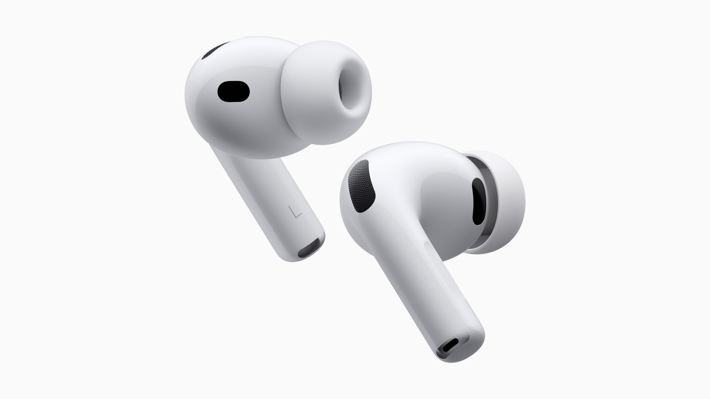

# Home

## Goal

A senior design lead should get the read in ten seconds: **brand designer, systems thinker, high craft, real shipped work.** Home shows six projects, not all of them.

## Structure

| # | Section | Components | Notes |
| --- | --- | --- | --- |
| 0 | Boot (first visit) | [Page Loader](../components/page-loader.md) | Home only |
| 1 | Nav | [Navigation](../components/navigation.md) | Same as every page |
| 2 | Hero | [Hero](../components/hero.md) (home) | Name, two-line descriptor, link list + ©2026, rule |
| 3 | Selected work | [Section Header](../components/section-header.md), [Project Grid](../components/project-grid.md) | 6 projects, 2 columns, "View all" right-aligned below |
| 4 | About Micah | Section Header, portrait [Media Frame](../components/media-frame.md), Body L, [Action](../components/action.md) "Read more" | Portrait left, copy right. Hovering the image or the link triggers both (image scale + link flip) |
| 5 | Scroll to top | [Scroll to Top](../components/scroll-to-top.md) | Right-aligned |
| 6 | Footer | [Footer](../components/footer.md) | Forest Green |
| n/a | Texture | [Grain Overlay](../components/grain-overlay.md) | Page-level |

## Example (condensed)

```html example bleed
<div class="mh-container" style="padding-block:20px 72px">
  <header class="mh-hero" style="padding-top:72px">
    <h1 class="mh-hero__name mh-text-display-xl">Micah Hoang</h1>
    <p class="mh-hero__descriptor mh-text-heading">Brand designer with a systems mind.</p>
    <div class="mh-hero__bar">
      <ul class="mh-link-list mh-label"><li><a class="mh-link" href="#">LinkedIn</a></li><li><a class="mh-link" href="#">Resume</a></li><li><a class="mh-link" href="#">Email</a></li><li><a class="mh-link" href="#">Cosmos</a></li></ul>
      <span class="mh-label">©2026</span>
    </div>
  </header>
  <section style="margin-top:72px">
    <h2 class="mh-text-display-m" style="margin:0 0 72px">Selected work</h2>
    <ul class="mh-project-grid">
      <li class="mh-project-card"><a class="mh-project-card__link" href="#"><div class="mh-project-card__meta mh-label"><span>1</span><span>/</span><span class="mh-flip"><span class="mh-flip__track"><span>Gaia</span><span aria-hidden="true">Gaia</span></span></span></div><div class="mh-media"></div></a><ul class="mh-tags"><li class="mh-tag">Visual identity</li><li class="mh-tag">UX/UI</li></ul></li>
      <li class="mh-project-card"><a class="mh-project-card__link" href="#"><div class="mh-project-card__meta mh-label"><span>2</span><span>/</span><span class="mh-flip"><span class="mh-flip__track"><span>AirPods Pro 3</span><span aria-hidden="true">AirPods Pro 3</span></span></span></div><div class="mh-media" data-stroke></div></a><ul class="mh-tags"><li class="mh-tag">2D motion</li><li class="mh-tag">3D motion</li></ul></li>
    </ul>
    <div style="display:flex;justify-content:flex-end;margin-top:40px"><a class="mh-action" href="#"><span class="mh-flip"><span class="mh-flip__track"><span>View all</span><span aria-hidden="true">View all</span></span></span></a></div>
  </section>
</div>
```

## Rules

- **Selected-work order** is a curation decision (current: Gaia, AirPods Pro 3, Peak Energy, Motion Connect 2025, Simon & Schuster, National Park Playing Cards). It comes from the CMS, not code.
- Six projects, never more. Everything else lives in the Index.
- No hero image. The first image a visitor sees is project 1.
- Vertical rhythm: about 144px from hero to Selected work, 72px from section title to grid, 144px before About.

## Framer mapping

- Selected work: `HomeSelectedWorkGrid` (`FecepLS`), which also owns the About portrait/link linked hover.
- Boot and transitions: `PageTransition` (`gmalnRr`).
- Home social labels: `TextEncryptionEffect` (`p7tSTaD`).
